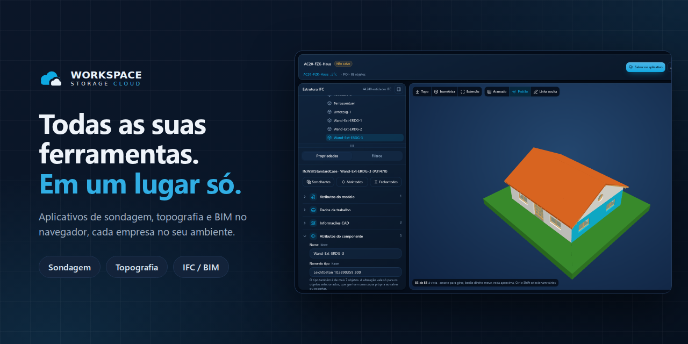
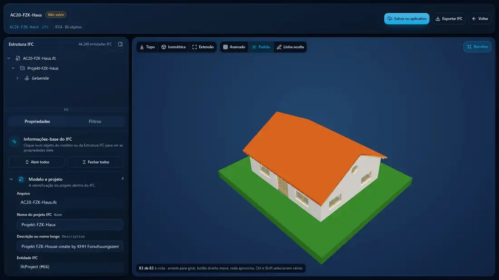
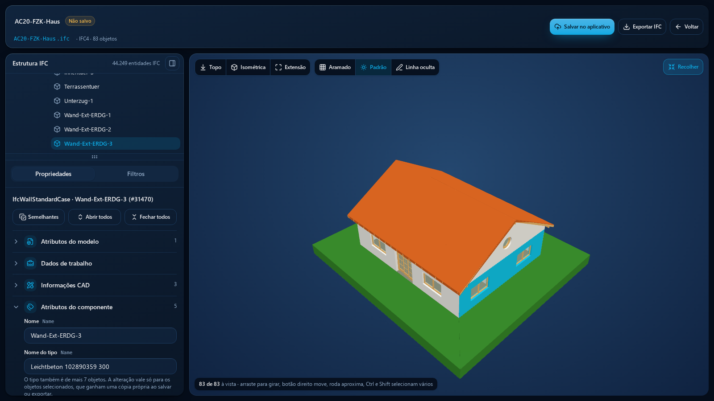
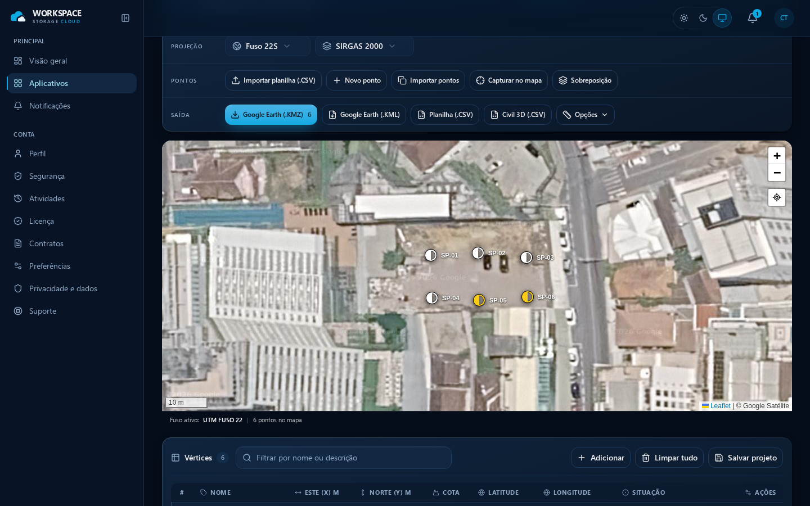
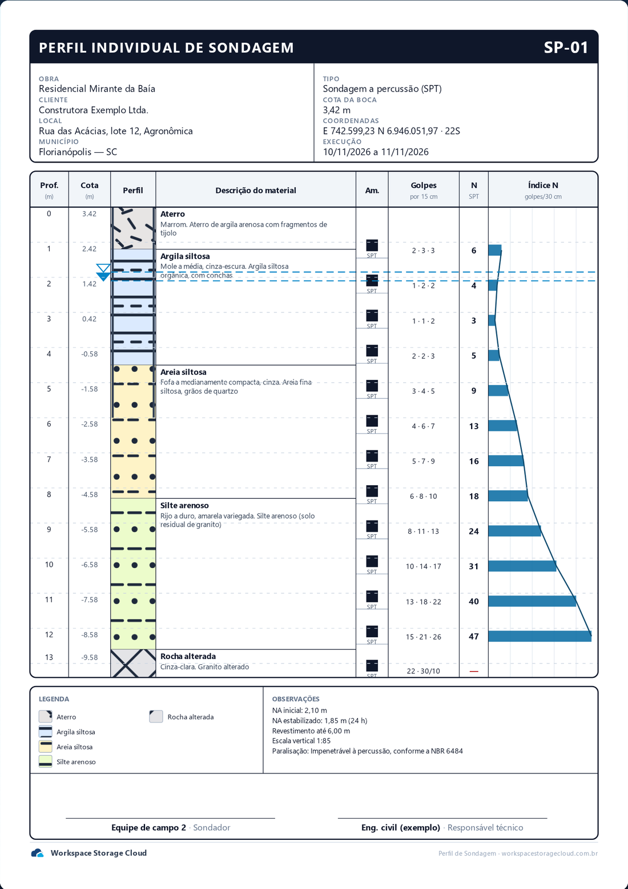
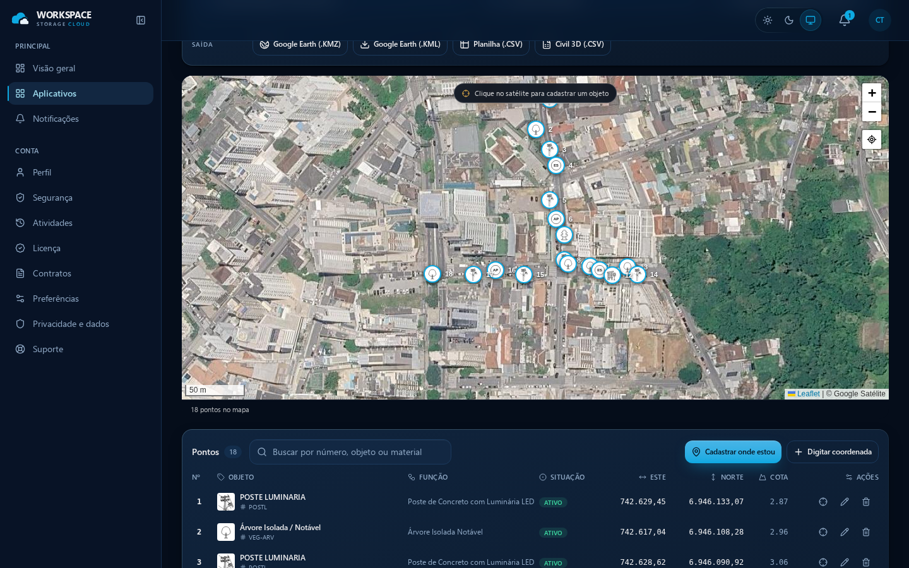
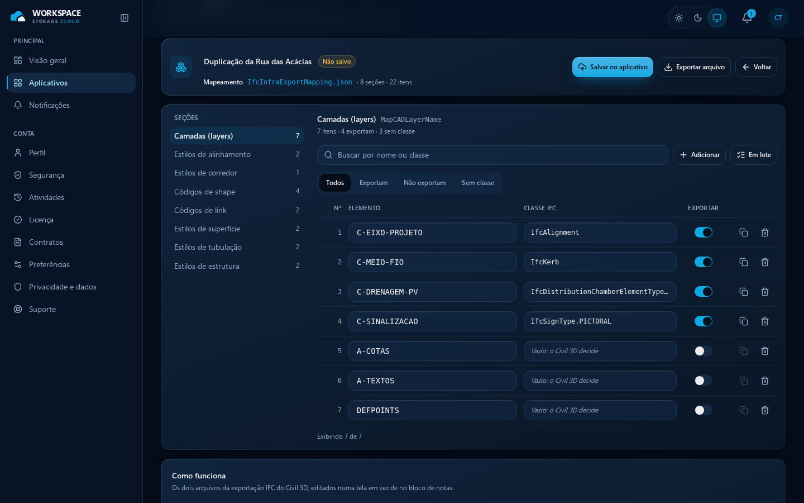
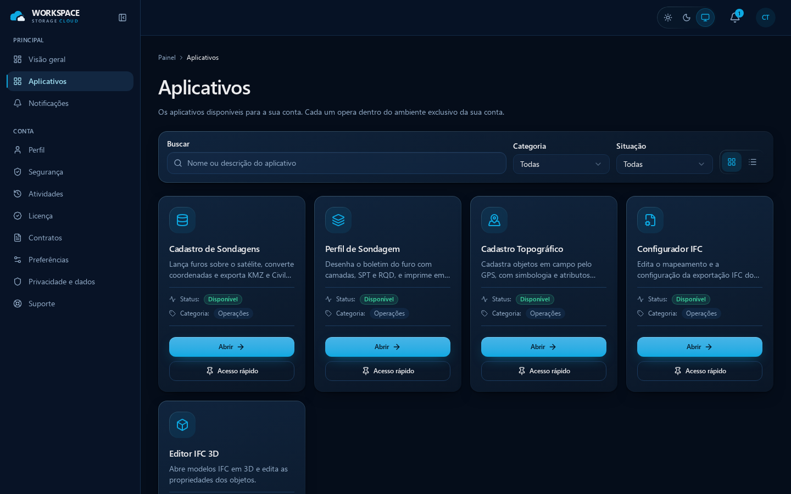
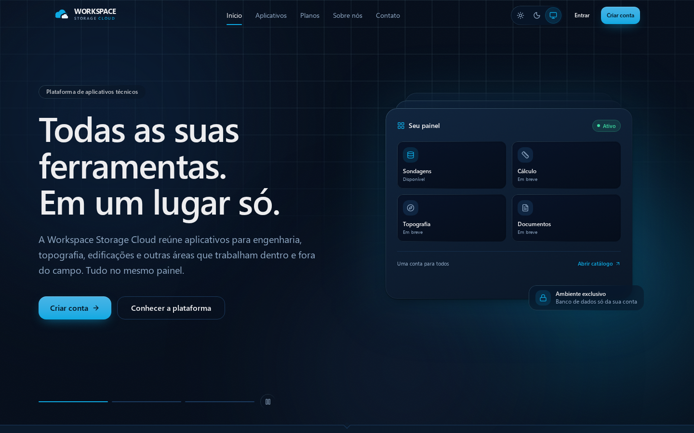
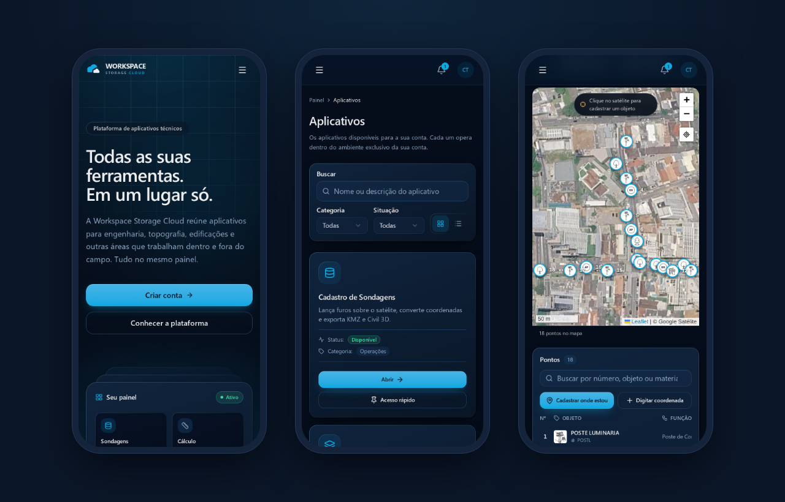

  

  <a href="https://workspacestoragecloud.com.br"><b>Conhecer a plataforma</b></a>
  &nbsp;·&nbsp; no navegador do computador ou do celular &nbsp;·&nbsp; licença anual

A Workspace Storage Cloud é uma plataforma de aplicativos para engenharia, topografia e BIM. Cada
cliente cria a conta, contrata a licença e trabalha num ambiente só dele, com os aplicativos lado a
lado no mesmo painel: cadastro e perfil de sondagens, cadastro topográfico em campo, configuração da
exportação IFC do Civil 3D e um editor de modelos IFC em 3D.

  

## Editor IFC 3D

  

Abre modelos IFC (IFC2X3, IFC4 e IFC4X3) de qualquer programa de BIM direto no navegador. A
estrutura do projeto aparece em árvore, e cada objeto mostra atributos, propriedades e tipo, todos
editáveis: dá para trocar a classe, mudar valores de vários objetos de uma vez e exportar um IFC
novo. O modelo é lido no próprio navegador e só vai para a conta quando a pessoa salva.

## Cadastro de Sondagens

  

Os furos entram por planilha, digitados ou clicando no satélite. O aplicativo converte as
coordenadas UTM, separa o que já foi executado do que está programado e exporta para Google Earth
(KMZ e KML), planilha e Civil 3D. Um código de acesso deixa outras pessoas trabalharem no mesmo
projeto.

## Perfil de Sondagem

  

O boletim do furo, como pede a NBR 6484: camadas com a hachura de cada solo, golpes do SPT, índice N
em gráfico, nível d'água e motivo da paralisação. A folha A4 é redesenhada a cada tecla e sai pronta
para imprimir ou salvar em PDF, com a logo e as assinaturas da empresa. Ligado a um furo do Cadastro
de Sondagens, o boletim já vem com coordenada e cota.

## Cadastro Topográfico

  

Postes, árvores, poços de visita, hidrantes, placas e outros elementos de via, cada um com o seu
símbolo técnico. No campo, o celular cadastra o ponto onde a pessoa está, pelo GPS e com foto. No
escritório, basta clicar no satélite. Sai em KMZ, KML, planilha e Civil 3D.

## Configurador IFC

  

O Civil 3D exporta para IFC a partir de dois arquivos JSON, mas não tem tela para editá-los. Aqui
eles abrem em português e separados por assunto: a classe IFC de cada camada, estilo e código, o
que entra ou fica de fora e as opções da exportação. O arquivo volta no mesmo formato em que entrou.

## O painel

  

Os aplicativos ficam num catálogo com busca e filtros, e os mais usados vão para o acesso rápido. Na
conta estão o perfil, a verificação em duas etapas, a licença, os contratos, a exportação dos dados
pessoais e o suporte por chamados. A equipe cuida de clientes, preços, cupons, contratos, e-mails e
newsletter numa área administrativa própria.

## O site

  

Páginas de aplicativos, planos, sobre e contato, nos temas claro e escuro. No cadastro, o CNPJ é
conferido na Receita na hora, e dá para entrar com a conta Google.

## No celular

  

Tudo funciona no celular, do site ao painel. No Cadastro Topográfico, é por ele que o técnico
registra os pontos em campo.

## Por dentro

A plataforma foi feita em Laravel com Inertia, React e TypeScript, com Tailwind CSS e componentes
shadcn/ui. Todos os clientes ficam num banco MariaDB só, e o isolamento é feito pela aplicação: toda
tabela de cliente leva o identificador do ambiente, e uma guarda recusa a consulta que chegue a ela
sem esse filtro. Assim tudo roda numa hospedagem compartilhada comum.

A licença anual é paga pelo Mercado Pago. A conta tem verificação em duas etapas, limite de sessões
simultâneas e trilha de auditoria, e cada página tem a sua política de segurança de conteúdo (CSP).
O 3D usa three.js e web-ifc, e os mapas, Leaflet. São mais de 700 testes automatizados.

Laravel · PHP 8.4 · Inertia · React · TypeScript · Tailwind CSS · MariaDB · three.js · web-ifc ·
Leaflet · Mercado Pago · PHPUnit

O código fica num repositório privado. Este repositório é a vitrine do projeto. As telas usam dados
de demonstração, e a casa do Editor IFC 3D é o modelo de exemplo AC20-FZK-Haus, do Instituto de
Tecnologia de Karlsruhe (KIT).

---

Feito por [Rodrigo Dias](https://github.com/rmgladius).
